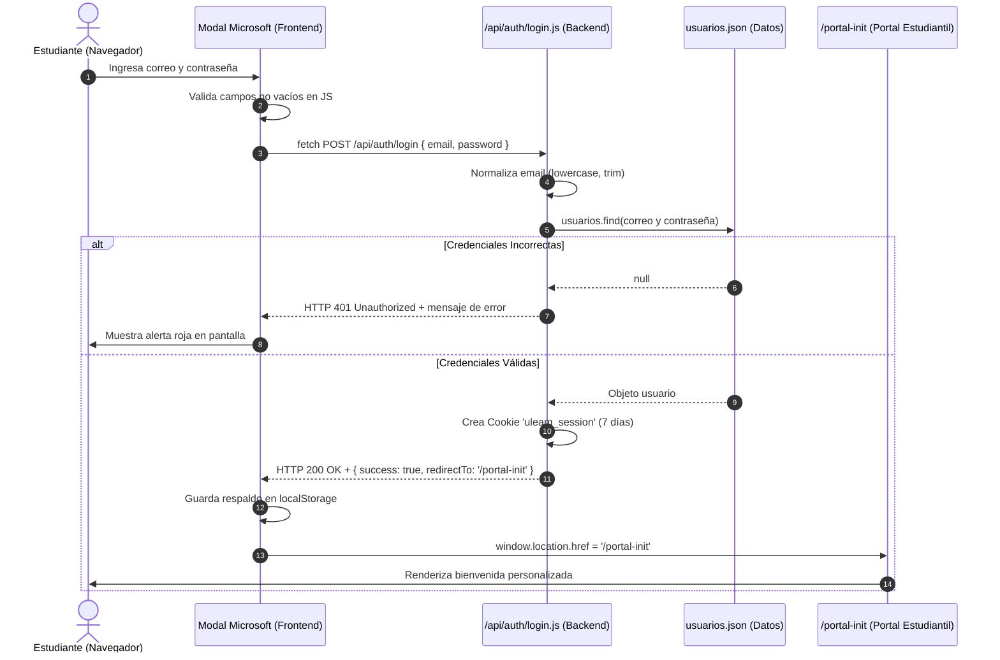

# Documentación de Autenticación con JavaScript (ULEAM)

Este directorio contiene los controladores de **autenticación de credenciales** para el sistema de Residencia Universitaria ULEAM, implementados con **JavaScript nativo** para entornos Astro (SSR/Node).

---

## 📂 Archivos del Módulo

| Archivo | Rol | Descripción |
| :--- | :--- | :--- |
| [`login.js`](./login.js) | **Endpoint POST** | Valida el correo y contraseña contra `usuarios.json`, genera la cookie de sesión y responde con el estado. |
| [`logout.js`](./logout.js) | **Endpoint POST / GET** | Elimina la cookie de sesión institucional y redirige al inicio. |
| [`usuarios.json`](../../../data/usuarios.json) | **Base de Datos Local** | Almacena el listado de usuarios estudiantiles válidos. |

---

## 🔄 Flujo de Autenticación Paso a Paso



---

## ⚙️ Explicación Técnica de Cada Etapa

### 1. Validación en el Frontend (`MicrosoftLoginModal.astro`)
Antes de enviar cualquier petición a la red:
- **Campos obligatorios:** Se comprueba que tanto `email` como `password` tengan texto válido. Si alguno está vacío, se enfoca el campo y se muestra una alerta sin consultar al servidor.
- **Prevención de envíos múltiples:** El botón *"Iniciar sesión"* se deshabilita (`disabled = true`) y se muestra un spinner animado (*"Procesando..."*).
- **Petición asíncrona:** Se utiliza la función nativa `fetch()` enviando un JSON con las cabeceras correspondientes:
  ```javascript
  const response = await fetch('/api/auth/login', {
    method: 'POST',
    headers: { 'Content-Type': 'application/json' },
    body: JSON.stringify({ email: email, password: password })
  });
  ```

---

### 2. Procesamiento en el Servidor (`login.js`)
El endpoint se ejecuta en el servidor cuando recibe una solicitud `POST`:

1. **Lectura y Limpieza del Cuerpo de la Solicitud:**
   ```javascript
   const body = await request.json();
   const cleanEmail = (body.email || '').toString().toLowerCase().trim();
   const cleanPassword = (body.password || '').toString();
   ```
   *Nota: `.toLowerCase().trim()` asegura que si el estudiante escribió mayúsculas o espacios accidentales, la autenticación no falle.*

2. **Búsqueda en el archivo JSON:**
   Se importa directamente el listado de usuarios y se busca coincidencia exacta:
   ```javascript
   const user = usuarios.find(
     (u) => u.email.toLowerCase().trim() === cleanEmail && u.password === cleanPassword
   );
   ```

3. **Manejo de Respuestas HTTP:**
   - **Caso de Error (401 Unauthorized):**
     Si el correo no existe o la contraseña no coincide, se devuelve un mensaje institucional:
     ```javascript
     return new Response(
       JSON.stringify({
         success: false,
         message: 'El correo electrónico o la contraseña son incorrectos.'
       }),
       { status: 401, headers: { 'Content-Type': 'application/json' } }
     );
     ```

   - **Caso de Éxito (200 OK):**
     Se prepara la sesión y se escribe la cookie HTTP en el navegador:
     ```javascript
     cookies.set('uleam_session', JSON.stringify(sessionData), {
       path: '/',
       httpOnly: false,
       maxAge: 60 * 60 * 24 * 7, // 7 días de vigencia
       sameSite: 'lax'
     });

     return new Response(
       JSON.stringify({
         success: true,
         user: sessionData,
         redirectTo: '/portal-init'
       }),
       { status: 200, headers: { 'Content-Type': 'application/json' } }
     );
     ```

---

### 3. Redirección y Acceso al Portal (`portal-init.astro`)
- Al recibir el estado `success: true`, el frontend redirige al usuario:
  ```javascript
  window.location.href = data.redirectTo || '/portal-init';
  ```
- Al cargar el portal, Astro extrae la información guardada en la cookie `uleam_session`:
  - Muestra el nombre real del estudiante: **`Joseph Coello Mendoza`**.
  - Genera las iniciales para el avatar: **`JC`**.
  - Muestra el rol: **`Estudiante`**.

---

### 4. Cierre de Sesión (`logout.js`)
Cuando el usuario pulsa **"↪ Cerrar sesión"**:
1. El enlace apunta a `/api/auth/logout`.
2. El servidor destruye la cookie `uleam_session`:
   ```javascript
   cookies.delete('uleam_session', { path: '/' });
   return redirect('/');
   ```
3. El script del frontend elimina cualquier copia local (`localStorage.removeItem('uleam_session')`) y el usuario vuelve a la pantalla de bienvenida no autenticado.

---

## 👤 Usuario de Prueba Configurado

- **Correo:** `e0953920949@live.uleam.edu.ec`
- **Contraseña:** `contraUSER123`
- **Rol:** Estudiante
- **Cédula:** 0953920949
